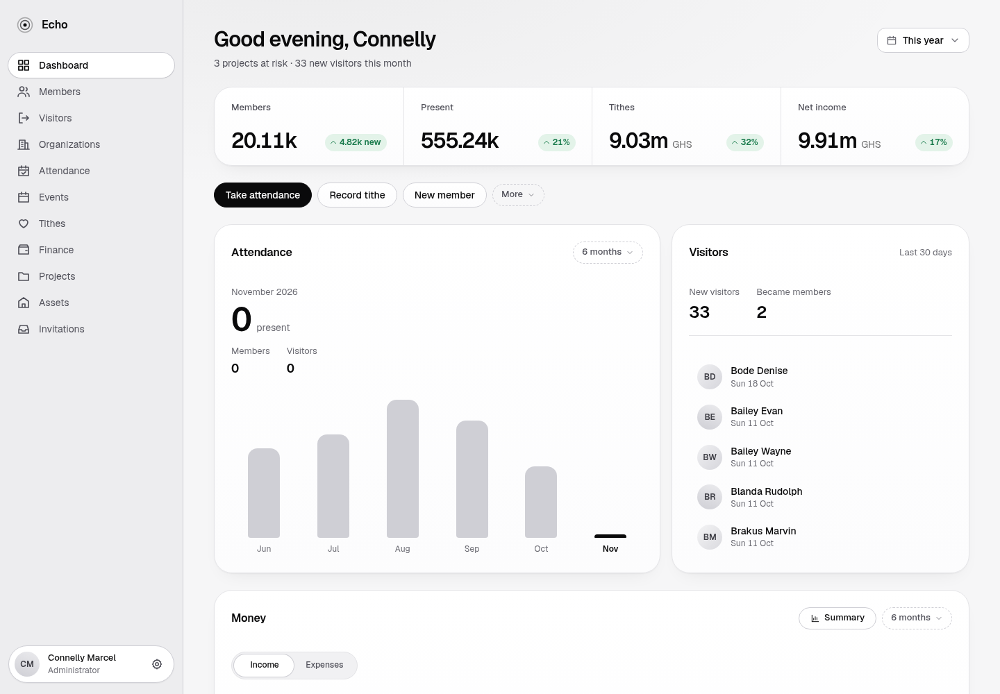

# Echo

A multi-tenant church management platform: congregations, members, events,
attendance, tithes and assets. One .NET API, one React app, one Postgres
database, run as a single Docker Compose project on one server. Every church
is a tenant whose data other tenants cannot see.

Echo is built for a small self-hosted deployment. It has no failover and one
server's capacity; [Limits](./docs/explanation/limits.md) says what that means.



## Quick start

You need Docker with the `docker compose` plugin, Git, the .NET 10 SDK (the
key script runs it) and a bash shell (on Windows, Git Bash or WSL).

```bash
git clone https://github.com/clintonbampoe/echo.git && cd echo
cp .env.example .env
# edit .env: MailClient__Address and Resend__ApiKey (ask a maintainer)
bash backend/tools/jwt-key-setup/SetupJwtKeys.sh env
bash backend/tools/invitation-key-setup/SetupInvitationKey.sh env
docker compose up
```

The two scripts write generated keys into `.env`. Without real Resend values,
email (verification, invitations, password reset) does not send. Open
http://localhost:8080 and create a church at `/signup/church`; the API
reference is at http://localhost:8080/scalar. The full walk-through, with the
output of each step, is [Getting started](./docs/getting-started.md).

## What is in it

| | |
|---|---|
| API | ASP.NET Core (minimal APIs), Entity Framework Core, Npgsql |
| Database | PostgreSQL 18 |
| Web app | React 19, TypeScript, Vite, TanStack Query |
| Front door | nginx: serves the web app, proxies `/api`, terminates HTTPS |
| Observability | Alloy, Loki, Prometheus, Tempo, Grafana; a Gatus status page |
| Tests | xUnit v3 with Testcontainers (backend), Vitest (frontend) |

## Documentation

[`docs/`](./docs/README.md) is organised by what you want to do: how-tos
(set up a server, release, restore a backup), reference (environment
variables, services, nginx, CI), and explanations (how it is put together, its
limits).

## Releases

A release is a version tag on `main`. `gh release create v0.1.2 --target main
--generate-notes` builds the images and deploys them to the server. Going back
is deploying an older version. See [Release](./docs/how-to/release.md).

## Contributing

- Bugs and feature requests: open an issue from a template.
- Security problems: do not open a public issue; see [SECURITY.md](./SECURITY.md).
- Code and review process: [CONTRIBUTING.md](./CONTRIBUTING.md).

Before pushing: `dotnet test --solution backend/Echo.slnx --filter "Category=Unit"`
and `cd frontend && npm run check`.

## License

See [LICENSE.md](./LICENSE.md).
