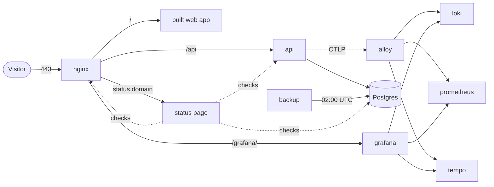

# How Echo is put together

One server runs everything, as one compose project (`echo`). This page says
what the pieces are and why they are arranged this way. For sizes and ports see
[Services](../reference/services.md).

## The services

- **nginx** is the single front door. It serves the built web app and proxies
  `/api`, `/grafana/` and `status.<domain>`. Details in [nginx](../reference/nginx.md).
- **api** is ASP.NET Core. Nginx sends it traffic once its health check passes.
- **db** is Postgres 18. It publishes no port in production; the API, backup,
  migrator, Alloy and the status page reach it over the compose network.
- **backup** dumps the database every night. **certbot** renews the
  certificate. Both report each run to the status page.
- **alloy, loki, prometheus, tempo, grafana** are [observability](./observability.md).
  **status** is the [status page](./status-page.md).
- **migrator** runs EF migrations and **seeder** loads fake data; both are
  one-shot and live under the `db-tools` profile.
- **client** is the Vite dev server. It exists in development only.

## Health endpoints

Both are public and need no token.

- `/api/health/live` asks "is this process up?". It has no external
  dependencies, so a database outage does not trip it. Compose uses it.
- `/api/health/ready` asks "should traffic go here?". It checks that the
  database is reachable and that all migrations are applied. A 503 with
  pending migrations means run the migrator.

## Why it is built this way

**One server.** Cost and fewer moving parts. The price is that there is no
failover: see [Limits](./limits.md).

**Build once, deploy the same bytes.** A release tag builds every image once on
GitHub's runners and pushes them to GHCR. The server only pulls them, so what
was built and tested is what runs. Config that must match the code (nginx,
Postgres, Alloy, Grafana dashboards) is baked into the images. The server
supplies only secrets and environment values.

**Every container restarts on every deploy, Postgres included.** One rule for
all services, with no exceptions to remember. A failed deploy goes back to the
whole previous release.

**Memory is capped, CPU is weighted.** A container that goes over its memory
limit restarts, so it cannot push the host into swap or the kernel's
out-of-memory killer. CPU weights decide who wins only when the CPUs are busy:
the database and nginx outrank the API, which outranks monitoring and jobs.

**Migrations must be backward compatible.** A rollback does not revert the
schema, so the previous release must work against the new schema. Add first,
remove in a later release. The deploy takes a dump before any pending
migration, on top of the nightly one.

**amd64 only.** The images are built for the server's architecture. Nothing is
cross-compiled and there is no emulation.

## How the images are built

Every Dockerfile is built with the repo root as the context. The API image has
three stages: restore (NuGet packages, rebuilt only when project files
change), publish (compile and publish) and runtime (the slim ASP.NET image
with the published output).

The API is published ReadyToRun: assemblies are compiled to native code at
build time, so a fresh container does not spend its first minute compiling the
code that serves requests. The assemblies roughly double in size and the build
takes about a minute longer. The runtime still recompiles hot methods with
full optimisation as the app runs. Its garbage collector is workstation and
concurrent (`ServerGarbageCollection` in `Echo.Api.csproj`); a load test showed
Server GC halves pause time but does not raise capacity.

The 12 released images, each with its Dockerfile:

| Image | Dockerfile |
|---|---|
| `echo-api` | `backend/src/Echo.Api/Dockerfile` |
| `echo-migrator` | `backend/src/Echo.MigrationService/Dockerfile` |
| `echo-nginx` | `infra/nginx/Dockerfile` (target `web`) |
| `echo-postgres` | `infra/postgres/Dockerfile` |
| `echo-backup` | `infra/postgres/backup/Dockerfile` |
| `echo-certbot` | `infra/certbot/Dockerfile` |
| `echo-status` | `infra/status/Dockerfile` |
| `echo-alloy` | `infra/alloy/Dockerfile` |
| `echo-loki`, `echo-prometheus`, `echo-tempo`, `echo-grafana` | `infra/observability/<name>/Dockerfile` |

The seeder has a Dockerfile (`backend/src/Echo.Seeder/Dockerfile`) but is not
released.
